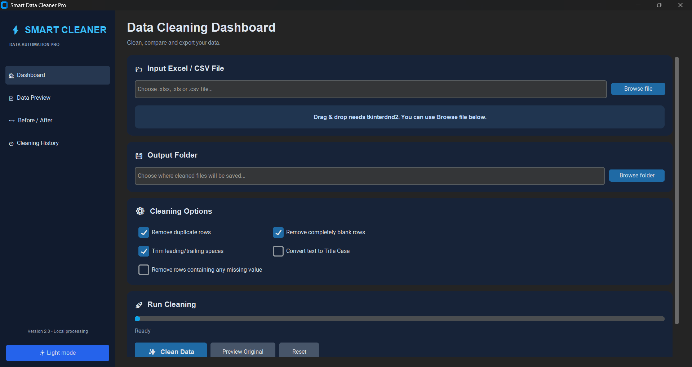
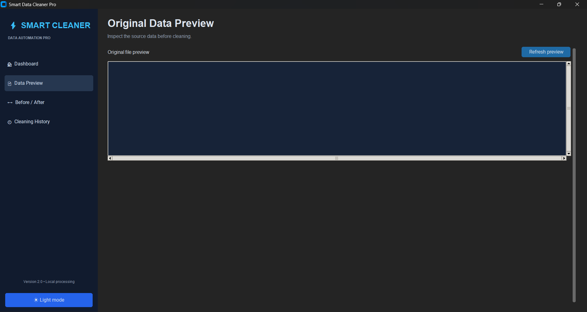
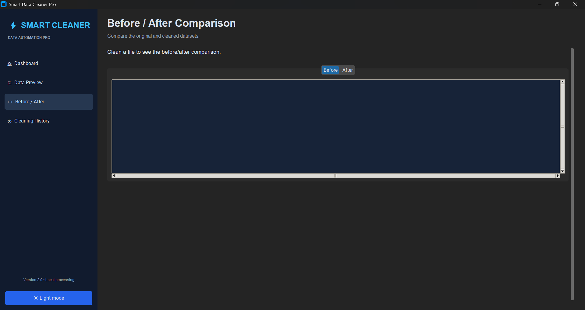
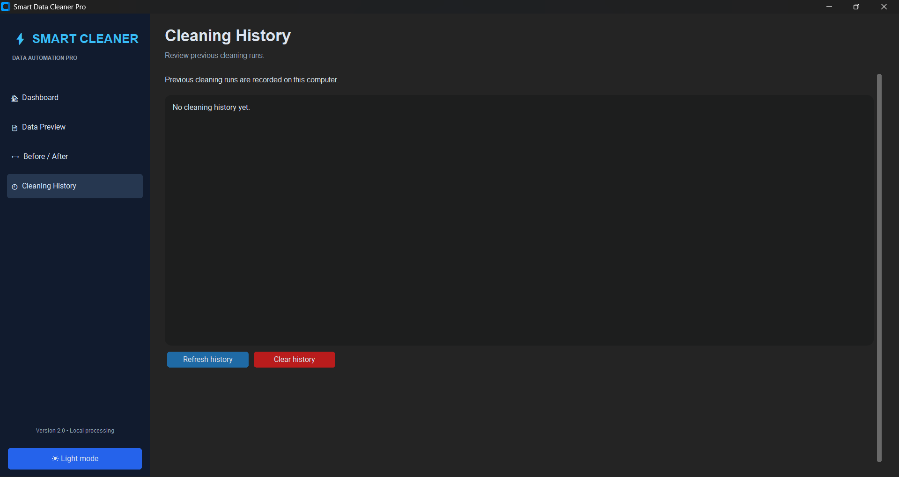

# Smart Data Cleaner Pro

A Python-based desktop application for automated Excel and CSV data cleaning.

## Features

- Import Excel and CSV files
- Remove duplicate rows
- Remove completely blank rows
- Remove leading and trailing spaces
- Convert text to Title Case
- Interactive data preview
- Before and after comparison
- Cleaning history
- Export cleaned files to Excel and CSV
- Light and Dark mode
- Optional drag-and-drop support

## Application Screenshots

### Dashboard


### Data Preview


### Before and After Comparison


### Cleaning Report


## Technologies Used

- Python
- CustomTkinter
- Pandas
- OpenPyXL
- Tkinter

## Installation

Clone the repository:

```bash
git clone https://github.com/LakhandRathod/smart-data-cleaner-pro.git
cd smart-data-cleaner-pro
```

Install dependencies:

```bash
python -m pip install -r requirements.txt
```

Run the application:

```bash
python app/main.py
```

## Project Structure

```text
smart-data-cleaner-pro/
├── app/
│   └── main.py
├── docs/
│   └── PROJECT_DOCUMENTATION.md
├── screenshots/
├── README.md
├── requirements.txt
└── .gitignore
```

## Author

**Lakhan Rathod**

GitHub: https://github.com/LakhandRathod

---

If you find this project useful, consider giving it a star!
